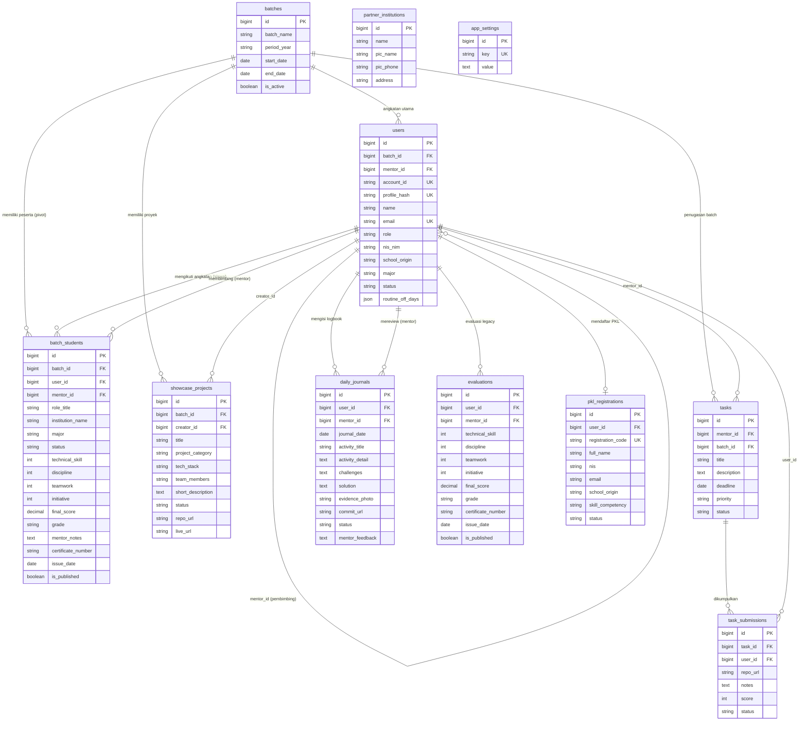

# Entity Relationship Diagram (ERD) — SIMAK-TMS

Dokumen ini menggambarkan struktur basis data relasional **SIMAK-TMS** (Sistem Informasi Manajemen Aktivitas, Karya & Sertifikasi Siswa PKL PT. Teknologi Multi Sistem), termasuk arsitektur **3-tabel Pivot** (`batches` $\leftrightarrow$ `batch_students` $\leftrightarrow$ `users`) untuk mendukung multi-angkatan dan multi-sertifikat per peserta.

---

## Diagram ERD (Mermaid)

---

## Ringkasan Relasi Utama

1. **Pivot Angkatan, Peserta, Mentor, Nilai & Sertifikat (`batches` $\leftrightarrow$ `batch_students` $\leftrightarrow$ `users`)**:
   - Satu peserta (`users.id`) dapat mengikuti lebih dari satu angkatan PKL (`batches.id`), misalnya saat SMK dan saat Kuliah.
   - Setiap keikutsertaan tercatat di `batch_students` dengan `mentor_id`, nilai 4 pilar (`technical_skill`, `discipline`, `teamwork`, `initiative`), `final_score`, `grade`, dan `certificate_number` yang berdiri sendiri per angkatan.
2. **Proyek Angkatan (`batches` $\rightarrow$ `showcase_projects`)**:
   - Setiap angkatan dapat memiliki lebih dari 1 proyek digital (`creator_id` + `team_members`).
3. **Logbook & Penugasan (`users` $\rightarrow$ `daily_journals`, `tasks`, `task_submissions`)**:
   - Logbook harian siswa diverifikasi oleh mentor pembimbing (`mentor_id`, `mentor_feedback`, `status`).
4. **Pengaturan Sistem (`app_settings`)**:
   - Menyimpan konfigurasi dinamis seperti `director_name`, `director_signature_name`, dan `director_title` untuk tanda tangan E-Sertifikat.
